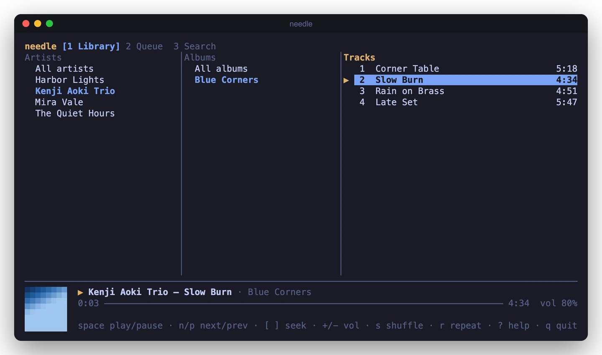
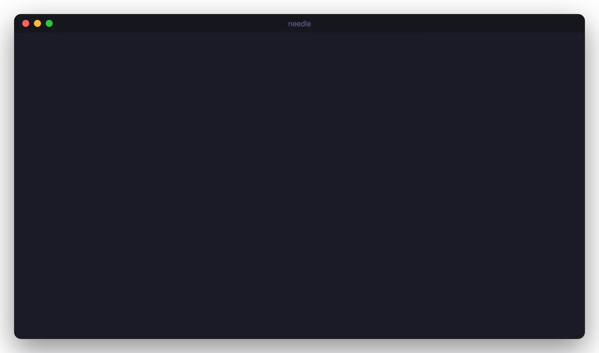
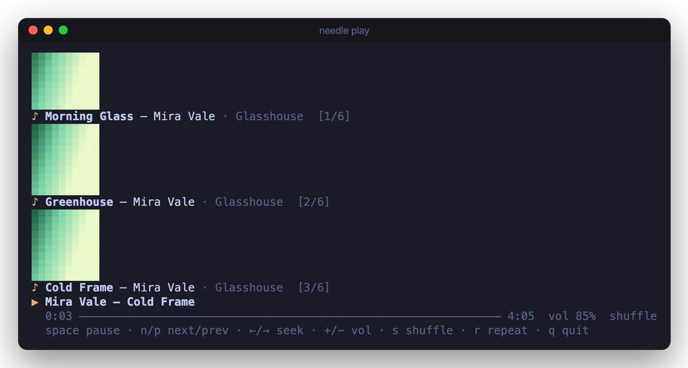
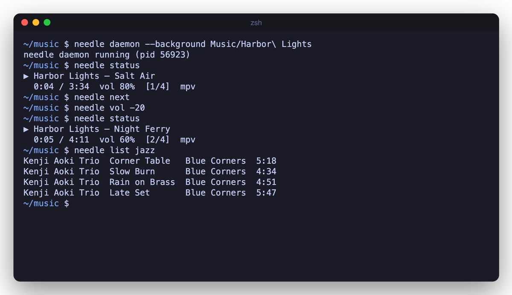

<div align="center">

# needle

A terminal music player with a full-screen TUI, a no-TUI mode that keeps your shell, a background daemon and a JSON-lines interface for scripts.

[Features](#features) · [Install](#install) · [Use it](#use-it) · [Keys](#keys) · [Configuration](#configuration) · [How it works](#how-it-works) · [Limits](#limits) · [Contributing](#contributing)




</div>

<!-- live-links -->
**Project page:** [gitguy268.github.io/needle](https://gitguy268.github.io/needle/) · [needle-theta-rosy.vercel.app](https://needle-theta-rosy.vercel.app)
<!-- /live-links -->

<!-- run-steps:start -->
## Run it locally, step by step

1. **Install [mpv](https://mpv.io):** `brew install mpv` on macOS or `sudo apt install mpv` on Debian and Ubuntu.

2. **Get the code:**

   ```sh
   git clone https://github.com/Gitguy268/needle.git
   cd needle
   ```

3. **Install [Go](https://go.dev/dl/) 1.27** or newer.

4. **Build it:**

   ```sh
   go build -o needle .
   ```

5. **Play some music:**

   ```sh
   ./needle play ~/Music/song.mp3
   ```

   Run `./needle` on its own for the full-screen player. See [Keys](#keys) below for how to quit and navigate.
<!-- run-steps:end -->

## Features

| Mode | Command | What you get |
|---|---|---|
| TUI | `needle` | Library in three columns (artist or genre, album, track), queue, live search, half-block cover art |
| Inline | `needle play <files>` | A few live lines under your prompt with single-key controls; the played tracks stay above as history |
| Plain | `needle play <files> \| cat` | One line per track, no escape codes, for pipes and logs |
| Daemon | `needle daemon --background` | Plays with no UI; `needle next`, `status`, `seek`, `vol` and more control it |
| JSON lines | `needle --headless`, `needle --raw` | Commands on stdin and events on stdout, or events only |
| Library | `needle index`, `needle list` | A SQLite index of your tags with search and grouping |

- **One player, many front ends.** The control commands reach whichever needle is running: the TUI, the inline player or the daemon.
- **Plays what mpv plays:** MP3, FLAC, AAC/M4A, Ogg, Opus, WAV, AIFF and more, as well as radio streams and `.m3u` playlists. On a Mac without mpv it falls back to the built-in `afplay`.
- **Cover art** from embedded pictures or `cover.jpg` / `folder.png` next to the files.
- **Optional Pedalboard effects:** `--fx bass|vocal|warm|loud` or your own EQ chain. Local tracks are rendered through Pedalboard into a cache, then played by mpv or afplay. Effects are off by default, and Python is never started unless you ask for them.



## Install

needle needs [mpv](https://mpv.io). On macOS it can also play through `afplay`, which ships with the system, but with fewer controls (see [Limits](#limits)).

```sh
brew install mpv          # macOS
sudo apt install mpv      # Debian, Ubuntu
```

Then install needle with Go 1.27 or newer:

```sh
go install github.com/Gitguy268/needle@latest
```

Or build it from a clone:

```sh
git clone https://github.com/Gitguy268/needle.git
cd needle
go build -o needle .
```

The binary is pure Go (no CGO), so it cross-compiles with `GOOS=linux` or `GOOS=darwin`. Optional: install ffmpeg so `needle index` stores track durations up front. Otherwise they're filled in as tracks play.

Effects are optional and need [Pedalboard](https://github.com/spotify/pedalboard), a Python package. needle still ships as one Go binary and starts Python only when effects are enabled:

```sh
python3 -m pip install pedalboard
```

Set `NEEDLE_PYTHON` to use a different interpreter, for example from a virtualenv. If effects are off, Python is never run. The effects tests and manual checks used Pedalboard 0.9.26.

## Use it

### Full-screen TUI

```sh
needle                  # your library; the first run scans ~/Music
needle ~/Downloads/album  # just these files, in the queue view
```

Pick an artist, an album or a track and press <kbd>Enter</kbd> to play it. <kbd>1</kbd> <kbd>2</kbd> <kbd>3</kbd> switch between Library, Queue and Search. <kbd>?</kbd> shows every key.

### Without the TUI

```sh
needle play ~/Music/Jazz
needle play song.flac https://radio.example/stream.mp3 mix.m3u
needle play --fx bass ~/Music/Jazz    # Pedalboard effects for local files
```



When stdout is a pipe or a file, `needle play` prints one plain line per track and exits when the queue ends:

```sh
needle play ~/Music/Ambient | tee played.txt
```

### Daemon and control commands

```sh
needle daemon --background ~/Music/Ambient   # or run it in the foreground without --background
needle status
needle next
needle vol -20
needle seek 1:30          # also +10, -10, 90
needle shuffle on
needle repeat all         # off, all, one
needle add ~/Music/more   # load replaces the queue instead
needle queue
needle jump 4
needle watch              # print each new track as it starts
needle quit
```



These commands talk over a Unix socket, so they also control a TUI or inline player that is already running. That makes them easy to bind to media keys or a status bar. Add `--json` to `status`, `queue` and `watch` for machine-readable output.

### JSON lines

`--headless` reads one JSON command per line on stdin and writes replies and events on stdout. `--raw` plays files and only writes events.

```sh
printf '%s\n' '{"cmd":"load","paths":["/music/a.flac"]}' '{"cmd":"seek","value":30}' | needle --headless
needle --raw ~/Music/song.mp3 | jq -r 'select(.event=="track") | .state.track.title'
```

<details>
<summary>Commands and events</summary>

Commands take `cmd` plus, depending on the command, `index` (queue position from 0), `path` or `paths`, `value`, `relative` and `mode`. An optional `id` is echoed in the reply.

| `cmd` | Fields | Does |
|---|---|---|
| `play` | `index` or `paths` (optional) | resume, play a queue position, or load and play paths |
| `pause`, `resume`, `toggle`, `stop` | | playback state |
| `next`, `prev` | | `prev` restarts the track after 3 seconds |
| `seek` | `value`, `relative` | seconds |
| `volume` | `value`, `relative` | 0 to 100 |
| `shuffle` | `mode`: `on`, `off`, `toggle` | |
| `repeat` | `mode`: `off`, `all`, `one`, `cycle` | |
| `add`, `load` | `path` or `paths` | files, folders, `.m3u` and URLs; `load` replaces the queue and plays |
| `clear`, `remove` | `index` for `remove` | |
| `status`, `queue` | | reply with `state` or `queue` |
| `subscribe` | `mode`: `positions` (optional) | stream events on this connection |
| `quit` | | stop the daemon or headless session |

Replies look like `{"ok":true,"state":{...}}` or `{"ok":false,"error":"..."}`. Events look like `{"event":"track","state":{...}}`, where `event` is one of `track`, `state`, `position` (once a second), `queue`, `error` or `finished`. The `state` object holds `status` (`stopped`, `playing`, `paused` or `loading`), `track`, `index`, `length`, `position`, `duration`, `volume`, `shuffle`, `repeat`, `backend` and `caps` (what the backend can do).

The same protocol runs on the daemon socket, so `socat - UNIX-CONNECT:$HOME/.cache/needle/needle.sock` works as a client too.

</details>

### Library

```sh
needle index                       # scan the folders in config.toml (default ~/Music)
needle index ~/Music ~/Downloads   # or these
needle list jazz                   # words match title, artist, album and genre
needle list --artist "Mira Vale" --album Glasshouse
needle list --group artists        # or albums, genres
needle list --search rain --paths > rain.m3u && needle play rain.m3u
needle list --json
```

Rescans only read files whose size or modification time changed. In the TUI, <kbd>u</kbd> rescans.

### Cover art

`needle art song.flac` prints a cover once. It uses Kitty graphics in Kitty and Ghostty, iTerm2 images in iTerm2 and WezTerm, Sixel in foot and mlterm, and half blocks everywhere else (`--mode` picks one). The TUI and the inline player always draw half blocks, which survive redraws in every terminal with colour.

## Keys

<details>
<summary>TUI</summary>

| Key | Action |
|---|---|
| <kbd>Space</kbd> | play / pause |
| <kbd>n</kbd> <kbd>p</kbd> | next / previous |
| <kbd>[</kbd> <kbd>]</kbd> · <kbd>{</kbd> <kbd>}</kbd> | seek 5 s · 30 s |
| <kbd>+</kbd> <kbd>-</kbd> | volume |
| <kbd>s</kbd> <kbd>r</kbd> <kbd>S</kbd> | shuffle · repeat mode · stop |
| <kbd>1</kbd> <kbd>2</kbd> <kbd>3</kbd> or <kbd>Tab</kbd> | Library · Queue · Search |
| <kbd>/</kbd> | search |
| <kbd>↑</kbd> <kbd>↓</kbd> <kbd>j</kbd> <kbd>k</kbd>, <kbd>PgUp</kbd> <kbd>PgDn</kbd>, <kbd>g</kbd> <kbd>G</kbd> | move |
| <kbd>←</kbd> <kbd>→</kbd> <kbd>h</kbd> <kbd>l</kbd> | library column |
| <kbd>Enter</kbd> | play the selection (on a track: the whole list, from that track) |
| <kbd>a</kbd> · <kbd>A</kbd> | add to the queue · add all search results |
| <kbd>b</kbd> | browse by genre instead of artist |
| <kbd>d</kbd> <kbd>D</kbd> <kbd>c</kbd> | queue: remove · clear · go to current |
| <kbd>u</kbd> | rescan the music folders |
| <kbd>?</kbd> · <kbd>q</kbd> | help · quit |

</details>

<details>
<summary>Inline player</summary>

| Key | Action |
|---|---|
| <kbd>Space</kbd> | play / pause |
| <kbd>n</kbd> <kbd>p</kbd> | next / previous |
| <kbd>←</kbd> <kbd>→</kbd> · <kbd>Shift</kbd>+<kbd>←</kbd> <kbd>→</kbd> | seek 5 s · 30 s |
| <kbd>+</kbd> <kbd>-</kbd> | volume |
| <kbd>s</kbd> <kbd>r</kbd> | shuffle · repeat mode |
| <kbd>q</kbd> | quit |

</details>

## Configuration

Everything works without a config file. To change something, copy [`config.toml.example`](config.toml.example) to `~/.config/needle/config.toml`:

```toml
music_dirs = ["~/Music", "/Volumes/NAS/Music"]
backend = "auto"     # auto, mpv or afplay
volume = 80
art = "auto"         # auto, halfblock, kitty, iterm, sixel or off

[effects]
enabled = false      # off unless you ask for it
preset = "bass"      # bass, vocal, warm or loud
cache_mb = 1024      # processed WAV cache under ~/.cache/needle/effects
# [[effects.chain]]  # a custom chain replaces the preset
# type = "PeakFilter"
# cutoff_frequency_hz = 250
# gain_db = -2.5
# q = 1.0

[theme]
accent = "#e0af68"   # "#rrggbb" or an ANSI number such as "13"
dim = "8"
select = "#7aa2f7"
```

Two themes are built in, Nujabes and Ye: Graduation. Set `name = "nujabes"` or `name = "graduation"` under `[theme]`, and remove the colour lines, because colours set in the file override the preset. The TUI recolours the terminal where the terminal allows it, and both the TUI and the inline player show a line of text from the theme. Both themes are unofficial tributes; see [NOTICE](NOTICE).

Flags override it for one run: `--backend`, `--volume`, `--shuffle`, `--repeat`, `--art`, `--fx`, `--theme`. `--theme` takes `default`, `nujabes` or `graduation`. `--fx` takes `off`, `bass`, `vocal`, `warm`, `loud` or `custom` (the chain from config).

| File | Default | Override |
|---|---|---|
| Config | `~/.config/needle/config.toml` | `$XDG_CONFIG_HOME` |
| Library index | `~/.local/share/needle/library.db` | `$XDG_DATA_HOME` |
| Daemon log | `~/.local/share/needle/daemon.log` | `$XDG_DATA_HOME` |
| Control socket | `~/.cache/needle/needle.sock` | `$XDG_RUNTIME_DIR`, `$NEEDLE_SOCKET` |
| Effects cache | `~/.cache/needle/effects` | `$XDG_CACHE_HOME` |
| Extra mpv options | | `$NEEDLE_MPV_ARGS`, for example `--ao=null` or `--audio-device=...` |
| Python for effects | `python3` on `PATH` | `$NEEDLE_PYTHON` |

## How it works

<details>
<summary>Design</summary>

- **`core`** owns the queue, shuffle order, repeat and the event stream, and knows nothing about terminals. Every front end (TUI, inline, plain, daemon, JSON lines) drives the same `core.Player`.
- **Backends** sit behind one interface with a `Capabilities` struct, and the front ends hide the controls a backend lacks.
  - mpv runs as a child process in idle mode. It is connected through a socket pair (`--input-ipc-client=fd://3`), so it quits when needle does.
  - afplay runs once per track. It is paused with `SIGSTOP`/`SIGCONT`, its position comes from the wall clock, and `afinfo` gives the duration.
- **Effects are a wrapper backend.** `backend/fx` sits in front of mpv or afplay. For a local track it asks a long-lived Python helper to apply a Pedalboard chain, writes a 24-bit WAV into the cache, then hands that file to the normal backend. Streams and URLs bypass it. The key includes the path, size, mtime, chain, Pedalboard version and helper version, so edits and upgrades re-render; the cache evicts the oldest files above `cache_mb`.
- **One protocol.** `proto` defines the JSON-lines commands and events. The daemon socket (mode 0600), `--headless` and `--raw` all use it, and the control subcommands are thin socket clients.
- **The library** is SQLite through the pure-Go `modernc.org/sqlite`, with tags read by `dhowden/tag`. Indexing is parallel and incremental.
- **Terminal safety.** Tags and stream titles are stripped of control characters before they reach the screen.

</details>

## Limits

- **macOS and Linux only.** The daemon uses a Unix socket, and the afplay fallback is macOS-only.
- **No gapless playback.** Each track is loaded on its own, so there can be a short gap between tracks.
- **The afplay fallback is basic.** It cannot seek or play URLs, volume changes apply from the next track, and pausing stops the process.
- **Image protocols are limited to `needle art`.** Kitty, iTerm2 and Sixel output is checked against each protocol's byte format in tests, but it hasn't been tried in those terminals yet. The TUI and inline player use half blocks.
- **Effects are offline and local only.** Pedalboard renders each track before it plays, so the first play is slower; later plays use the cache. A whole track is decoded into memory while it renders, which matters for very long files. Streams play without effects, and a format Pedalboard cannot decode plays unchanged (set `NEEDLE_FX_DEBUG=1` to see why). Changing the chain, the file or the Pedalboard version re-renders. There is no real-time visualiser, lyrics, scrobbling or streaming-service login.

## Contributing

Bug reports, ideas and pull requests are welcome. See [CONTRIBUTING.md](CONTRIBUTING.md) for building and the checks, [SECURITY.md](SECURITY.md) for reporting security problems privately, and the [Code of Conduct](CODE_OF_CONDUCT.md).

## Credits

needle's design borrows ideas, not code, from [cliamp](https://github.com/bjarneo/cliamp), [musikcube](https://github.com/clangen/musikcube), [listnr](https://github.com/sammwyy/listnr), [Kronos](https://github.com/TrevorSatori/kronos) and [haskell-player](https://github.com/potomak/haskell-player). [NOTICE](NOTICE) says which idea came from where, and lists the libraries needle is built with.

## License

[MIT](LICENSE) © 2026 Lucas Van De Weerd. Third-party licences are listed in [NOTICE](NOTICE). Pedalboard is GPL-3.0 and is used only as a separate, optional Python program; it is not linked into needle.
